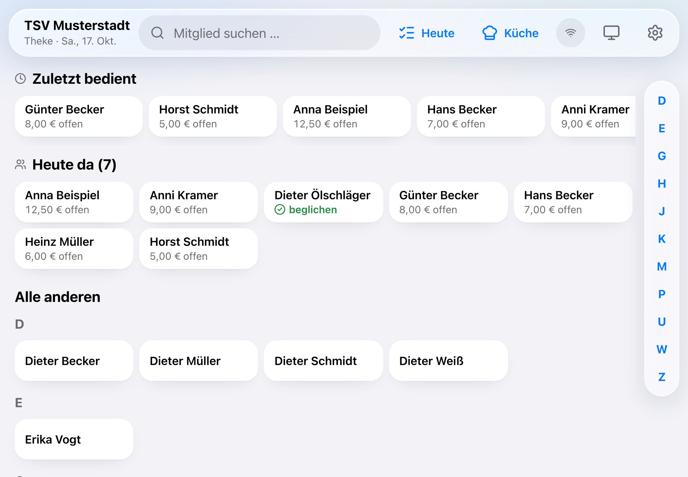
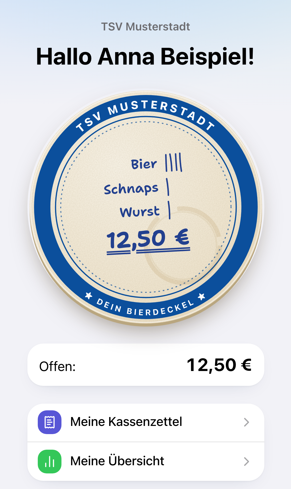
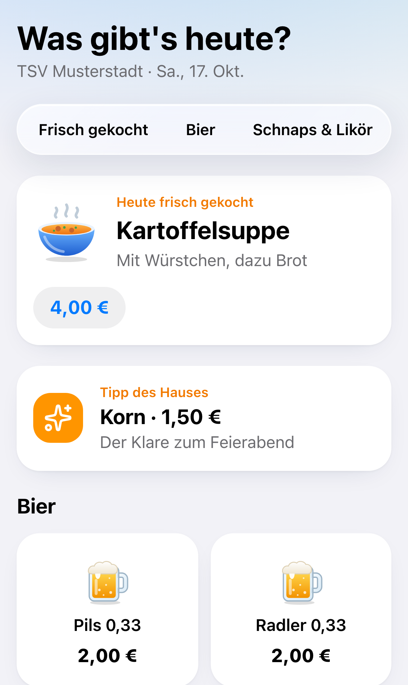
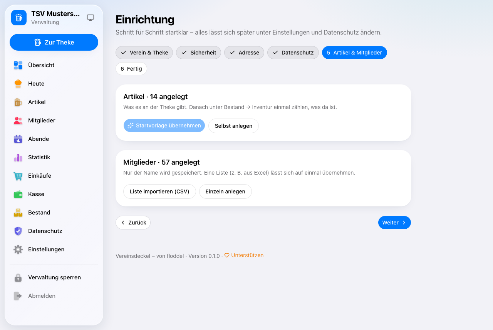

# Vereinsdeckel

**Der digitale Bierdeckel für Vereine** – Theke auf dem Tablet, Bierdeckel auf dem Handy,
Bestand und Kasse im Blick. Kostenlos und frei (AGPL-3.0).

## Was er kann

- **Theke auf dem Tablet:** Mitglied antippen, Getränke und Essen buchen, Gäste, Storno, Umbuchen –
  funktioniert auch, wenn das WLAN im Vereinsheim wegbricht.
- **Bezahlen:** bar mit Rückgeld-Rechner oder per PayPal-QR, Teilzahlung, Trinkgeld.
- **Bierdeckel aufs Handy:** Jedes Mitglied sieht über seinen persönlichen QR-Code, was auf seinem
  Deckel steht – mit Strichen wie auf dem echten Bierdeckel –, seine Kassenzettel und kann Essen bestellen.
- **Karte am Tresen:** „Was gibt's heute?“ per QR-Aufsteller – aktuelle Preise, Tagesgericht, Tipp des Hauses.
- **Verwaltung:** Artikel, Mitglieder (auch per Liste), Einkäufe mit Belegfoto, Bestand und Inventur,
  Handkasse und PayPal, Abendabschluss, Statistik, PDFs und CSV-Exporte.
- **Aufgeräumt und gut lesbar:** große Tasten, klare Farben, Hell oder Dunkel (auch automatisch wie
  das Gerät) – auf Tablet, Computer und Handy.
- **In euren Vereinsfarben:** sieben fertige Farben oder die eigene per Regler (Farbton und
  Kräftigkeit). Die App passt Helligkeit und Kontrast selbst an, damit alles hell wie dunkel lesbar bleibt.
- **Testphase:** vor dem Start in Ruhe ausprobieren und danach gezielt aufräumen – z. B. nur die
  Testmitglieder samt ihren Buchungen löschen, Inventur und Anfangsbestand bleiben. Gelöscht wird alles
  auf einmal oder gar nichts, vorher gibt es eine Sicherung. Mit „Testphase beenden“ sind alle
  Buchungen ab dem ersten echten Abend dauerhaft geschützt.
- **Sicher:** Login mit zweitem Faktor, Verwaltungs-PIN, nur ein Admin-Konto, alle Buchungen unveränderlich.
- **Datenschutz:** Von Mitgliedern wird nur der Name gespeichert. Keine Tracker, keine Werbung, keine
  fremden Schriften. Auskunft und Löschen per Knopfdruck, Datenschutzhinweis inklusive.

Alles freiwillig: Wer kein Handy nutzen mag, bestellt und bezahlt wie immer vorne an der Theke.

  
  

Wie alles im Einzelnen funktioniert: [docs/bedienung.md](docs/bedienung.md)

> **Keine Registrierkasse.** Der Vereinsdeckel ist eine Hilfe für Vereine, keine zertifizierte Kasse
> im Sinne der KassenSichV (keine TSE). Ob und wie ihr ihn einsetzen dürft, klärt bitte mit eurem
> Vorstand bzw. eurer steuerlichen Beratung.

## Installieren

| Weg | Für wen | Anleitung |
|---|---|---|
| **Vercel + Neon** | ohne eigenen Server, ein Klick | [docs/installation-vercel.md](docs/installation-vercel.md) |
| **Docker** | NAS (z. B. Synology), Raspberry Pi, eigener Server | [docs/installation-docker.md](docs/installation-docker.md) |

[](https://vercel.com/new/clone?repository-url=https%3A%2F%2Fgithub.com%2Ffloddel%2Fvereinsdeckel&project-name=vereinsdeckel&repository-name=vereinsdeckel&env=BETTER_AUTH_SECRET%2CSETUP_CODE&envDescription=Zwei%20lange%20Zufallswerte%3A%20Geheimschl%C3%BCssel%20%28mind.%2032%20Zeichen%29%20und%20Einrichtungs-Code%20%28mind.%2016%20Zeichen%29%20%E2%80%93%20z.%20B.%20aus%20einem%20Passwort-Generator.&envLink=https%3A%2F%2Fgithub.com%2Ffloddel%2Fvereinsdeckel%2Fblob%2Fmain%2Fdocs%2Finstallation-vercel.md%23die-zwei-werte&stores=%5B%7B%22type%22%3A%22integration%22%2C%22integrationSlug%22%3A%22neon%22%2C%22productSlug%22%3A%22neon%22%2C%22protocol%22%3A%22storage%22%7D%5D)

Danach führt ein **Einrichtungsassistent** im Browser durch alles Weitere: Verein und Logo,
Admin-Konto mit zweitem Faktor, Datenschutz, Artikel (mit Startvorlage) und Mitglieder.

**Umziehen** (z. B. von Vercel auf den eigenen Server) geht über Verwaltung → Einstellungen →
**Sichern & Umziehen**.

## Unterstützen

Der Vereinsdeckel ist kostenlos und wird in der Freizeit entwickelt. Wenn er eurem Verein hilft:

- [GitHub Sponsors](https://github.com/sponsors/floddel)
- [PayPal](https://paypal.me/xygoht)

Fehler gefunden oder eine Idee? Gern als [Issue](https://github.com/floddel/vereinsdeckel/issues).
Sicherheitslücken bitte vertraulich melden, siehe [SECURITY.md](SECURITY.md).

## Lizenz

Copyright © 2026 floddel. Freie Software unter der **GNU Affero General Public License v3.0** –
nutzen, weitergeben und verändern erlaubt; wer eine veränderte Version für andere betreibt, legt
deren Quellcode offen und lässt den Hinweis „Vereinsdeckel – von floddel“ sichtbar.
Details: [LICENSE](LICENSE) und [NOTICE.md](NOTICE.md). Ohne jede Gewährleistung.

Mitentwickeln: [docs/entwicklung.md](docs/entwicklung.md)
