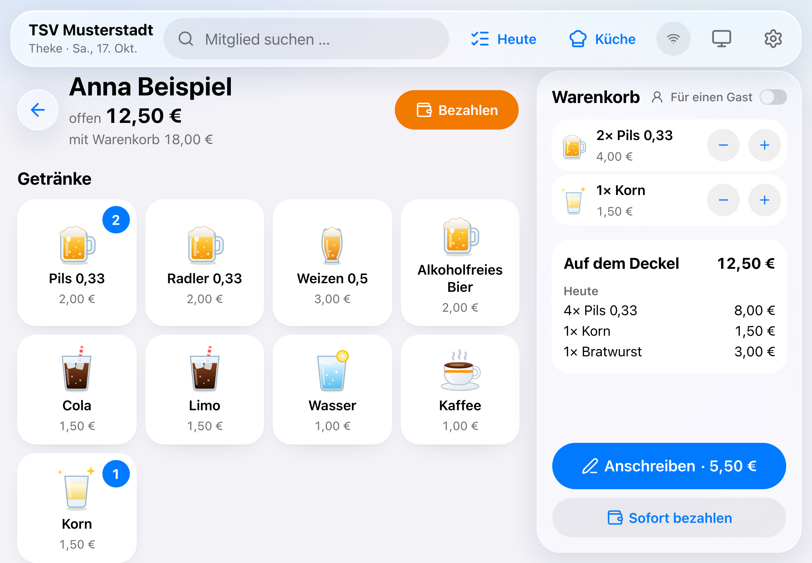
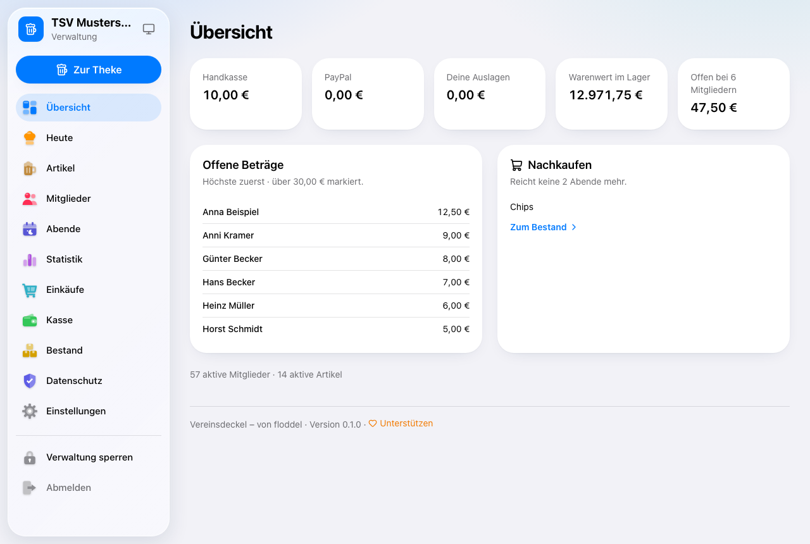
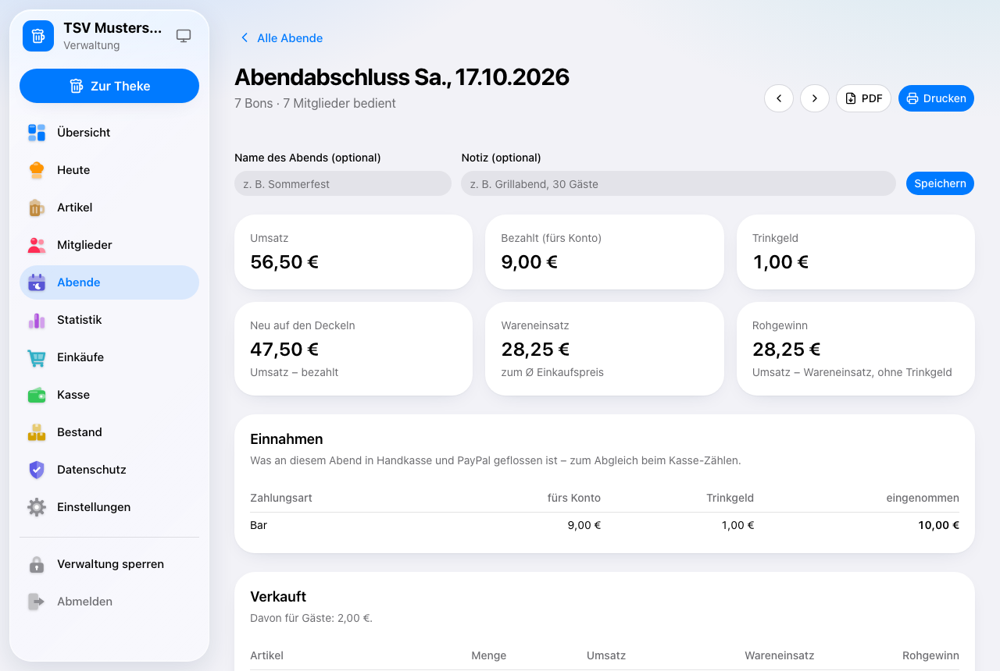

# Bedienung

Der Vereinsdeckel hat drei Bereiche:

| Bereich | Wer | Wo |
|---|---|---|
| **Theke** | wer gerade hinter dem Tresen steht | auf dem Tablet, `/theke` |
| **Verwaltung** | der Betreiber (mit PIN) | am Tablet oder Computer, über „Verwaltung“ |
| **Bierdeckel** | jedes Mitglied | auf dem eigenen Handy, über den persönlichen QR-Code |

Dazu kommt die **Karte „Was gibt's heute?“** für alle (QR-Aufsteller am Tresen).

---

## Theke

### Tablet einrichten

1. Auf dem Tablet die Adresse des Vereinsdeckels öffnen und anmelden.
2. **iPad:** Teilen-Symbol → „Zum Home-Bildschirm“. **Android:** Menü ⋮ → „Zum Startbildschirm hinzufügen“.
3. Ab jetzt die Theke über das neue Symbol öffnen – sie läuft im Vollbild und bleibt ein Jahr angemeldet.

**Hell oder Dunkel?** Der runde Knopf oben (Bildschirm, Sonne oder Mond) wechselt zwischen
**Automatisch** (wie das Tablet), **Hell** und **Dunkel**. Abends im Vereinsheim ist Dunkel oft angenehmer.

### Buchen

1. **Mitglied antippen** – oben stehen die, die heute schon etwas bekommen haben („Heute“), darunter
   alle nach Anfangsbuchstaben. Oder oben bei **„Mitglied suchen“** ein paar Buchstaben tippen.
2. **Artikel antippen** – jeder Tipp legt eins in den Warenkorb, mit − und + korrigieren.
3. **„Anschreiben“** – fertig, es steht auf dem Deckel.
   Oder **„Sofort bezahlen“**, wenn direkt bezahlt wird.

**Für einen Gast:** den Schalter „Für einen Gast“ einschalten – die Artikel werden als Gast-Bestellung
gekennzeichnet (bezahlt wird über das Mitglied).

**Vertippt?** Nach jedem Buchen erscheint kurz **„Rückgängig“** – ein Tipp, und es ist weg.

### Storno und Umbuchen

Beim Mitglied unten stehen die Bons des Abends:

- **Stornieren:** Bon antippen → „Stornieren“ → Menge wählen → Grund antippen
  („Falsch getippt“, „Doppelt gebucht“, „Falsches Mitglied“, „Sonstiges“).
- **Umbuchen:** „Umbuchen“ → das richtige Mitglied suchen → bestätigen. Storno und neue Buchung
  passieren in einem Schritt.
- **Zahlung stornieren:** genauso bei der Zahlung.

An der Theke geht das für den **laufenden Abend**. Ältere Abende korrigiert ihr in der Verwaltung
(Abende → Abend → „Bons und Zahlungen“).

### Bezahlen

1. Beim Mitglied **„Bezahlen“**.
2. **Bar:** Betrag wählen (alles oder „Anderer Betrag“), Gegeben eintippen – die App rechnet das
   **Rückgeld**. „Passend“ oder „Stimmt so“ machen den Rest zum Trinkgeld.
3. **PayPal:** Das Mitglied scannt den **PayPal-QR-Code** mit dem Handy und zahlt; danach den Eingang
   bestätigen. (Dafür in den Einstellungen den PayPal.me-Namen eintragen.)

Ist ein Deckel über der eingestellten Grenze, erinnert die Theke ans Bezahlen.

### Ohne Internet

Bricht das WLAN weg, steht oben **„Keine Verbindung“** – einfach weiterbuchen. Die Theke merkt sich
alles und schickt es nach, sobald das Internet wieder da ist („… warten“ zählt herunter).

### Essen per Handy

1. Oben **„Küche“** → **„Küche offen“** einschalten (nur dann können Mitglieder bestellen).
2. Neue Bestellungen erscheinen in der Leiste **„Handy-Bestellungen“** mit Ton.
3. **„Annehmen“** → **„Fertig“** (das Handy zeigt „bitte abholen“) → **„Abgeholt“** – erst dann wird
   es auf den Deckel gebucht.

Welche Gerichte bestellbar sind, legt ihr beim Artikel fest („Per Handy bestellbar“, nur Essen).

---

## Bierdeckel auf dem Handy

  
  

- Jedes Mitglied bekommt eine **QR-Karte** (Verwaltung → Mitglieder → „QR-Codes drucken“).
- Mit der Handy-Kamera scannen → der eigene Bierdeckel öffnet sich, mit Strichen wie auf Pappe.
- Dazu: **Kassenzettel** der letzten Abende (auch als PDF), eine **Übersicht** und – wenn die
  Küche offen ist – **Essen bestellen**.
- Die Seite ist hell; wer mag, stellt oben auf **Dunkel** um (gilt nur für das eigene Handy).
- Der Link ist geheim. Geht eine Karte verloren: Verwaltung → Mitglied → **„Link sperren“** bzw.
  neuen Link erzeugen.

Alles freiwillig – wer kein Handy nutzt, macht alles wie immer vorne an der Theke. Eine einfache
Erklärung für Mitglieder steht unter `/so-gehts` (verlinkt von der Karte).

---

## Heute an der Theke (Karte am Tresen)

Verwaltung → **„Heute“**:

- **Heute frisch gekocht:** Selbst Gekochtes (Eintopf, Salat …) für heute einschalten – mit
  Beschreibung und Preis. Es steht dann auf der Karte und an der Theke und **verschwindet am nächsten
  Tag von selbst**.
- **Tipp des Hauses:** ein Artikel mit Spruch ganz oben auf der Karte – mit Vorschlägen, was schon
  lange im Schrank steht.
- **Aufsteller drucken:** ein A4-Blatt, in der Mitte knicken – steht als Dreieck auf dem Tresen, mit
  dem QR-Code zur Karte auf beiden Seiten.

Die Karte zeigt nur, was da ist, mit aktuellen Preisen. Kurze Beschreibungen für Gäste („fruchtig,
halbtrocken“) tragt ihr beim Artikel unter „Beschreibung für die Karte“ ein.

---

## Verwaltung

Über **„Verwaltung“** an der Theke, dann die **PIN** eingeben. Die Verwaltung sperrt sich nach
15 Minuten ohne Nutzung wieder; „Verwaltung sperren“ geht sofort.

| Menü | Wofür |
|---|---|
| **Übersicht** | Handkasse, PayPal, Auslagen, Warenwert, offene Deckel, was nachgekauft werden muss |
| **Heute** | Tagesgericht, Tipp des Hauses, Aufsteller (siehe oben) |
| **Artikel** | Was es gibt: Schalter rechts in der Liste, ausgeschaltet ist ein Artikel an der Theke und auf der Karte ausgeblendet (der Bestand bleibt). Preise, Symbole, Reihenfolge an der Theke, Ausschank (z. B. 4 cl aus der 0,7-l-Flasche), „Bestand aus“ (z. B. Glas Wein aus der Flasche) |
| **Mitglieder** | anlegen (auch als Liste aus Excel), Link sperren/erneuern, QR-Karten drucken, Kontoauszug, Datenauskunft |
| **Abende** | Abendabschluss je Abend (Umsatz, Zahlungen, Trinkgeld, Rohgewinn) als PDF, Korrekturen für frühere Abende |
| **Statistik** | Umsatz und Renner im Zeitraum, Vergleich mit dem Vorzeitraum, Ladenhüter |
| **Einkäufe** | Einkauf mit Belegfoto erfassen (optional per KI vom Kassenbon), bezahlt aus Handkasse, PayPal oder privat (dann als Auslage) |
| **Kasse** | Handkasse und PayPal: Einlagen, Entnahmen, Erstattung von Auslagen, Kasse zählen, Kassenbuch als PDF/CSV |
| **Bestand** | was da ist, wie lange es reicht, Einkaufsliste; **Inventur** (zählen, was wirklich da ist) |
| **Datenschutz** | Datenschutzhinweis, Checkliste, Wo läuft die App?, Auftragsverarbeiter |
| **Einstellungen** | Darstellung, Vereinsfarbe, Testphase, Vereinsname, Logo, PayPal, Warngrenze, KI für Kassenbons, PIN, Passwort, zweiter Faktor, angemeldete Geräte, **Sichern & Umziehen** |

### Aussehen

Einstellungen, ganz oben:

- **Darstellung:** Automatisch (wie das Gerät), Hell oder Dunkel. Dazu der Regler **Glas** – von
  „klar“ bis „milchig“, wie stark Leisten und Menüs durchscheinen. Beides gilt nur für das Gerät,
  an dem ihr es einstellt.
- **Vereinsfarbe:** Blau, Petrol, Grün, Gold, Rot, Lila, Graphit – oder **Eigene**: Farbton und
  Kräftigkeit mit zwei Reglern frei wählen. Gilt für alle – Theke, Verwaltung, Karte und die Bierdeckel
  auf den Handys. Die App passt Helligkeit und Kontrast selbst an, damit jede Farbe hell und dunkel
  gut lesbar bleibt.

### Testphase

Bis zum ersten echten Abend dürft ihr alles ausprobieren. Unter Einstellungen → **„Testphase“**:

- **Daten zurücksetzen:** ankreuzen, was weg soll – Buchungen, Kasse, Einkäufe (auf Wunsch ohne den
  Anfangsbestand), Inventuren, Mitglieder, Artikel. Was davon abhängt, wird automatisch mit
  angekreuzt (z. B. Mitglieder → ihre Buchungen). Vorher eine Sicherung herunterladen, dann
  „LÖSCHEN“ eintippen. Gelöscht wird alles auf einmal oder – bei einem Fehler – gar nichts.
  Beispiel: Inventur und Anfangsbestand sind echt, die Testmitglieder sollen weg → nur „Mitglieder“
  ankreuzen.
- **Testphase beenden – jetzt geht's los:** ab dann sind alle Buchungen dauerhaft geschützt.
  Das lässt sich **nicht rückgängig** machen, auch nicht nach einem Umzug per Sicherung.

---

## Sicherheit

- **Ein Admin-Konto** mit Passwort und **zweitem Faktor** (Code aus einer Authenticator-App).
  Die Notfall-Codes ausdrucken und zu Hause aufbewahren.
- **PIN** für die Verwaltung – die Theke bleibt ohne PIN bedienbar, kann aber nur den laufenden
  Abend ändern.
- **Tablet verloren?** Am Handy anmelden → Einstellungen → „Angemeldete Geräte“ → abmelden, am
  besten zusammen mit einem neuen Passwort.
- Alle Buchungen sind **unveränderlich** – Korrekturen sind immer ein sichtbarer Storno mit Grund.

## Sichern & Umziehen

Einstellungen → **„Sichern & Umziehen“**:

- **Sicherung herunterladen** – alle Daten als eine Datei (ohne Passwort, PIN und Schlüssel).
  Regelmäßig machen und gut aufheben: Die Datei enthält die geheimen Mitglieder-Links.
- **Aus einer Sicherung übernehmen** – nur in eine frische Installation, z. B. beim Umzug von
  Vercel auf einen eigenen Server: „Stammdaten + aktueller Bestand“ (Neustart) oder „Alles“.
  Lässt sich die Datei am Mac in Safari nicht auswählen („Hochladen“ bleibt grau), zieht sie einfach
  aus dem Finder auf das Feld „Datei auswählen“.
